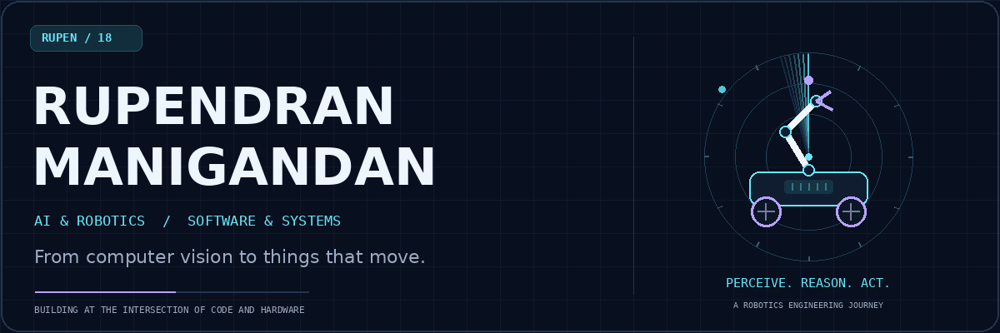
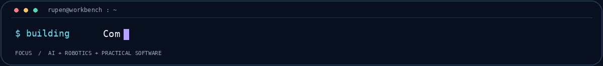
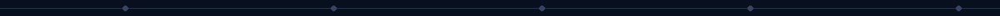
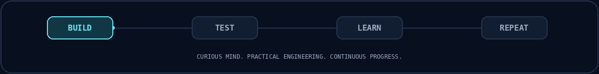

<!-- Custom animations are self-hosted in assets/. Static alternatives respect reduced-motion preferences. -->

  <picture>
    <source media="(prefers-reduced-motion: reduce)" srcset="assets/hero-still.png" />
    
  </picture>

  <strong>AI & Robotics Student &nbsp; / &nbsp; Computer Vision &nbsp; / &nbsp; Practical Software</strong>

  <a href="#about">About</a> &nbsp;·&nbsp;
  <a href="#featured-work">Featured Work</a> &nbsp;·&nbsp;
  <a href="#the-toolbox">Toolbox</a> &nbsp;·&nbsp;
  <a href="#on-the-workbench">Now Building</a> &nbsp;·&nbsp;
  <a href="#the-contribution-playground">Activity</a>

  
  

  <picture>
    <source media="(prefers-reduced-motion: reduce)" srcset="assets/workbench-still.png" />
    
  </picture>

## About

I’m **Rupendran Manigandan**, pursuing **B.E. Computer Science & Engineering — AI & Robotics** at **Sathyabama Institute of Science and Technology**.

I enjoy making software interact with the world: a model that spots a weld defect, a robotic arm that moves an object, or an application that makes a task easier. My work brings together **computer vision, embedded systems, networking, and desktop software**.

**🥈 Project highlight:** GeoX received **2nd Prize at an international project expo in Thailand**.

<picture><source media="(prefers-reduced-motion: reduce)" srcset="assets/signal-still.png" /></picture>

## Featured Work

<table>
<tr>
<td width="50%" valign="top">

01 / ROBOTICS & MANIPULATION

### 🦾 [GeoX](https://github.com/RUPEN-18/GEO_X)

A **6-DOF mobile manipulator rover** combining a wheeled base and a robotic arm. The repository documents my third-year hardware project and preserves the available partial Python source.

**Focus:** movement control · robotic actuation · sensing

<a href="https://github.com/RUPEN-18/GEO_X">Explore GeoX →</a>

</td>
<td width="50%" valign="top">

02 / APPLIED COMPUTER VISION

### 🔍 [WeldSight AI](https://github.com/RUPEN-18/WeldSight-AI)

A **YOLO-based visual weld inspection application** for images and video, with confidence filtering, visual severity estimates, and PDF inspection reports.

**Built with:** Python · YOLO · OpenCV · PySide6

<a href="https://github.com/RUPEN-18/WeldSight-AI">Explore WeldSight →</a>

</td>
</tr>
<tr>
<td width="50%" valign="top">

03 / SAFETY MONITORING

### 🦺 [SiteGuard](https://github.com/RUPEN-18/SiteGuard-PPE-Detection)

A **construction-site PPE monitoring application** for helmet and reflective-jacket checks, worker counts, violation records, and exportable reports.

**Built with:** Python · YOLO · Tkinter · SQLite

<a href="https://github.com/RUPEN-18/SiteGuard-PPE-Detection">Explore SiteGuard →</a>

</td>
<td width="50%" valign="top">

04 / SOFTWARE & SYSTEMS

### 🖥️ [NovaFleet](https://github.com/RUPEN-18/NovaFleet-Endpoint-Management)

A **Windows admin–client management system** for approved software deployment, device status, remote controls, and inactivity-based shutdown.

**Built with:** C# · .NET · WPF · Client–Server Networking

<a href="https://github.com/RUPEN-18/NovaFleet-Endpoint-Management">Explore NovaFleet →</a>

</td>
</tr>
</table>

### More from the lab

| Project | What I built |
| :--- | :--- |
| **[Dataset Doctor](https://github.com/RUPEN-18/DatasetDoctor-YOLO-Dataset-Auditor)** | A local desktop auditor for YOLO datasets, annotation inspection, and report exports. |
| **[Wireless Display](https://github.com/RUPEN-18/WirelessDisplay-AndroidTV)** | A Windows sender and Android TV receiver for local-network screen casting with FFmpeg. |
| **[VisionForge AI](https://github.com/RUPEN-18/VisionForge-YOLOv8-Object-Detection)** | A Streamlit YOLOv8 detection studio for images and video, with model controls and exports. |
| **[StudyTrack](https://github.com/RUPEN-18/StudyTrack-Study-Planner)** | A study planner with session logging, a focus timer, daily tasks, streaks, and progress charts. |
| **[SmartBin](https://github.com/RUPEN-18/SmartBin-Arduino-Waste-Segregator)** | An Arduino Uno wet/dry waste segregation project using ultrasonic sensing, moisture sensing, and a servo. |

<picture><source media="(prefers-reduced-motion: reduce)" srcset="assets/signal-still.png" /></picture>

## The Toolbox

**Languages & applications**

  
  
  
  
  

**Vision & robotics**

  
  
  
  
  

**Engineering tools**

  
  
  
  

## On the Workbench

| Building | Learning | Exploring |
| :--- | :--- | :--- |
| **AURA** — an indoor robotic assistant combining voice interaction, owner authentication, and embedded control. | **C++, Python & DSA** — clearer logic, stronger fundamentals, and better problem-solving. | **Computer vision & autonomous systems** — connecting perception with useful software and physical actions. |

<picture><source media="(prefers-reduced-motion: reduce)" srcset="assets/signal-still.png" /></picture>

## The Contribution Playground

<strong>One contribution at a time.</strong>

  <picture>
    <source media="(prefers-color-scheme: dark)" srcset="https://raw.githubusercontent.com/RUPEN-18/RUPEN-18/output/github-contribution-grid-snake-dark.svg" />
    <source media="(prefers-color-scheme: light)" srcset="https://raw.githubusercontent.com/RUPEN-18/RUPEN-18/output/github-contribution-grid-snake.svg" />
    
  </picture>

<strong>📊 Open GitHub analytics</strong>

 

  
  

  

Language charts describe repository code composition, not proficiency.

 

## Let’s Talk Engineering

Interested in **robotics, computer vision, embedded systems, and useful software**? Explore a project, open an issue, or connect with me here on GitHub.

  

  <picture>
    <source media="(prefers-reduced-motion: reduce)" srcset="assets/build-loop-still.png" />
    
  </picture>

